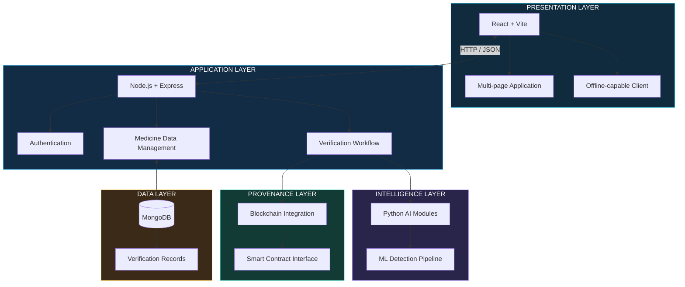
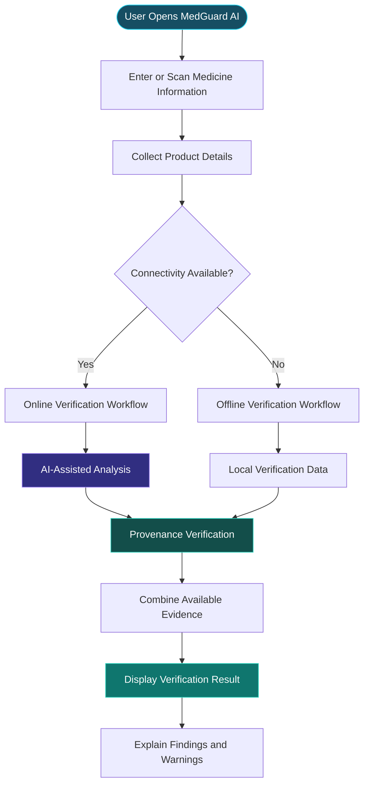
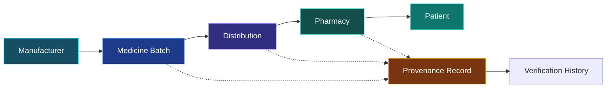
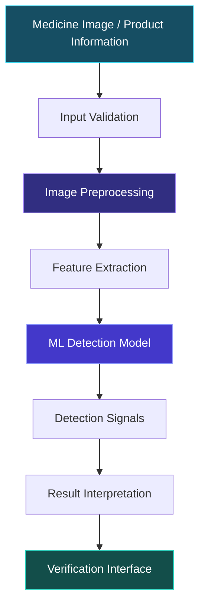
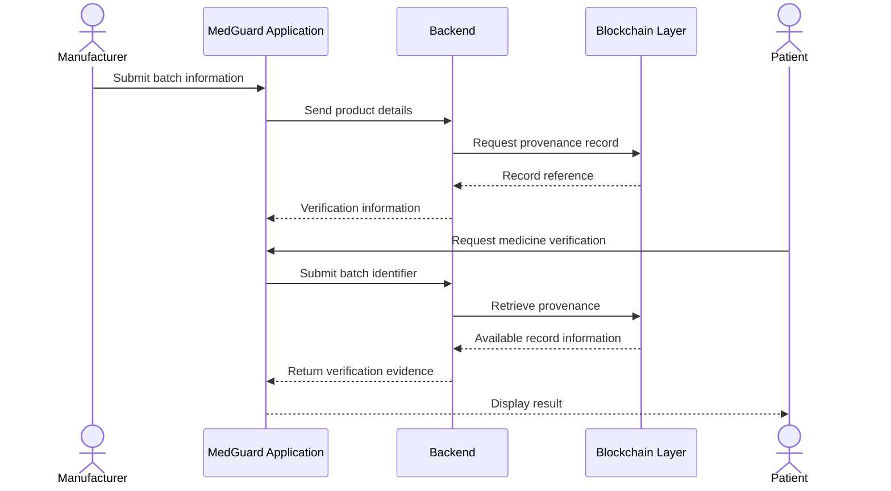
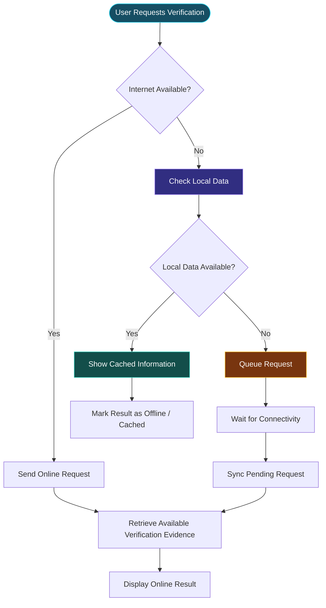

 <div align="center">

# 🛡️ MedGuard AI

### Trust Every Medicine. Verify Every Source.


<p>
<strong>An intelligent medicine verification platform exploring AI-based counterfeit detection, blockchain-backed provenance, and accessible medicine authentication.</strong>
</p>

<p>
  <a href="https://github.com/Sarthaktanpure/MedGuardAI">
    
  </a>
  
  
  
</p>

<p>
  
  
  
  
  
  
  
</p>

</div>

---

## `~/the-problem`

A medicine's packaging may look genuine. Its label may appear legitimate. But how can a patient, pharmacist, or healthcare worker verify where that medicine came from?

Counterfeit medicines create serious risks across healthcare supply chains. Traditional verification processes can be fragmented, difficult to access, and dependent on centralized information.

The challenge becomes even greater in areas with limited internet connectivity.

### The problems MedGuard AI explores

| Challenge | Why it matters |
|---|---|
| Counterfeit medicines | Patients may unknowingly purchase unsafe products |
| Limited traceability | Medicine origin and supply-chain history can be difficult to verify |
| Fragmented verification | Information may be distributed across different systems |
| Limited connectivity | Online-only verification can fail in low-connectivity environments |
| Trust and transparency | Patients need accessible ways to assess medicine authenticity |

## `~/the-approach`

**MedGuard AI** explores a unified medicine verification workflow combining three major technologies:

<box-placeholder />

| Layer | Responsibility |
|---|---|
| Artificial Intelligence | Analyze medicine-related information and support counterfeit detection |
| Blockchain | Explore tamper-evident provenance and verification records |
| Offline-first application | Make essential verification workflows accessible under limited connectivity |

The goal is to make medicine verification more transparent and accessible.

> **Core principle:** A medicine should not need a perfect internet connection to begin a verification journey.

---

## `~/system-architecture`

### 01 — Platform architecture

MedGuard AI is organized as a multi-part system with a React frontend, Node.js backend, and separate integration areas for AI and blockchain functionality.



*This is the intended system architecture. AI and blockchain components are represented as integration layers, not a claim that every service is already fully implemented.*

### 02 — Medicine verification workflow



### 03 — Medicine provenance lifecycle



---

## `~/core-capabilities`

### 01 — Medicine verification

The central application concept is to provide a structured workflow for checking medicine information.

- Medicine information input.
- Product and batch identification.
- Verification workflow.
- Authenticity-related indicators.
- Result explanation.

### 02 — AI-assisted detection

The AI integration is intended to support analysis of medicine-related information.

Potential analysis areas include:

- Medicine image analysis.
- Packaging and label inspection.
- Identification of suspicious product information.
- Pattern-based anomaly detection.
- Model-generated verification signals.

### 03 — Blockchain-backed provenance

The blockchain layer explores a tamper-evident way to represent medicine provenance.

- Batch identity.
- Manufacturer information.
- Supply-chain events.
- Verification history.
- Provenance record validation.

### 04 — Offline-first access

Connectivity should not be a prerequisite for every interaction.

The offline-first direction explores:

- Local access to available verification data.
- Cached information.
- Verification requests that can be queued.
- Synchronization when connectivity returns.

### 05 — Multi-page web application

The frontend provides a structured application experience through a React and Vite client.

---

## `~/ai-detection-pipeline`

The intended AI workflow separates image acquisition, preprocessing, model inference, and result interpretation.



### Why AI?

Medicine verification can involve several visual and informational signals.

Machine learning offers a way to explore patterns that may be difficult to identify through manual inspection alone.

However, a model prediction is not proof of authenticity. Real-world deployment requires representative training data, expert validation, and careful evaluation of false positives and false negatives.

---

## `~/blockchain-provenance`

Blockchain integration is intended to strengthen the traceability aspect of the platform.

### Conceptual record lifecycle



### Why blockchain?

Traditional databases can store medicine records, but an appropriately designed blockchain system can provide an additional tamper-evident record of provenance events.

The important engineering challenge is not simply writing data to a blockchain. It is designing trustworthy record creation, identity verification, event validation, and secure access.

*The sequence describes the proposed integration workflow; it should not be interpreted as proof of a completed production blockchain deployment.*

---

## `~/offline-first-design`

Offline support is an important design consideration for medicine verification.



### Important distinction

Cached information is not necessarily current information.

An offline verification interface should communicate:

- Whether the result came from a local cache.
- When the information was last synchronized.
- Whether a blockchain or remote verification check was unavailable.
- Whether the result is incomplete and needs an online check.

---

## `~/technology-stack`

| Layer | Technology | Responsibility |
|---|---|---|
| Frontend | React | User interface |
| Frontend tooling | Vite | Development and builds |
| Styling | Tailwind CSS | Responsive interface |
| Backend | Node.js | Server runtime |
| API | Express.js | Backend application |
| Database | MongoDB | Application persistence |
| AI services | Python | Machine-learning integration |
| Blockchain | Python integration scaffold / contracts area | Provenance integration |
| Development | npm workspaces | Frontend and backend organization |

### Repository structure

```text
MedGuardAI/
│
├── backend/
│   └── Express + MongoDB API
│
├── frontend/
│   └── React + Vite application
│
├── contracts/
│   └── Blockchain-related project area
│
├── docs/
│   └── Architecture and model documentation
│
├── shared/
│   └── Shared application resources
│
├── package.json
├── package-lock.json
├── vercel.json
└── README.md
```

---

## `~/getting-started`

### Prerequisites

- Node.js and npm.
- Git.
- MongoDB connection for backend development.

### 01 — Clone the repository

```bash
git clone https://github.com/Sarthaktanpure/MedGuardAI.git

cd MedGuardAI
```

### 02 — Install dependencies

The repository uses npm workspaces for its frontend and backend.

```bash
npm install
```

### 03 — Configure environment variables

Create the environment file using the repository's example configuration:

```bash
cp .env.example .env
```

On Windows PowerShell:

```powershell
Copy-Item .env.example .env
```

Fill in the values required by the backend configuration.

### 04 — Start the backend

```bash
npm run dev:backend
```

### 05 — Start the frontend

Open a separate terminal:

```bash
npm run dev:web
```

### 06 — Build the frontend

```bash
npm run build
```

*The root package scripts confirm the backend and web development commands. Configure the AI and blockchain services separately according to their implementation and dependencies.*

---

## `~/engineering-principles`

| Principle | Design goal |
|---|---|
| Offline-first | Reduce dependence on continuous internet connectivity |
| Explainability | Provide understandable verification evidence |
| Traceability | Preserve medicine provenance information |
| Modularity | Separate web, AI, and blockchain responsibilities |
| Data integrity | Protect the consistency of medicine records |
| Accessibility | Make verification approachable for different users |
| Responsible AI | Avoid treating model predictions as definitive proof |

---

## `~/responsible-verification`

Medicine authenticity is a safety-critical problem.

MedGuard AI is an engineering exploration, not a certified medicine authentication authority.

A responsible verification system should:

- Avoid declaring a medicine genuine based only on an image prediction.
- Clearly communicate uncertain or incomplete results.
- Preserve the source and timestamp of verification information.
- Avoid presenting unavailable provenance records as proof of counterfeiting.
- Encourage users to consult qualified pharmacists or regulatory authorities when authenticity is uncertain.
- Validate AI models against representative, independently verified datasets.

---

## `~/development-roadmap`

### Platform

- [ ] Complete medicine verification workflow.
- [ ] Expand product and batch information management.
- [ ] Add verification history.
- [ ] Improve user-facing explanations.

### AI

- [ ] Implement image-based medicine analysis.
- [ ] Build and evaluate counterfeit detection models.
- [ ] Add confidence and uncertainty handling.
- [ ] Document model performance and dataset limitations.

### Blockchain

- [ ] Finalize provenance data structure.
- [ ] Implement smart contract integration.
- [ ] Validate manufacturer and supply-chain events.
- [ ] Add provenance verification interface.

### Offline-first

- [ ] Implement local data caching.
- [ ] Add pending verification queue.
- [ ] Build synchronization logic.
- [ ] Show freshness and source indicators.

---

## `~/project-impact`

MedGuard AI combines several important engineering domains into one healthcare-focused problem.

| Domain | Engineering concepts |
|---|---|
| Full-stack development | React, Vite, Node.js and Express |
| Backend architecture | API services and modular organization |
| Database engineering | MongoDB |
| Artificial intelligence | Machine-learning service integration |
| Computer vision | Medicine image analysis direction |
| Blockchain | Provenance and tamper-evident records |
| Offline systems | Local data and synchronization design |
| Healthcare technology | Medicine verification and patient safety |

The central engineering challenge is connecting these technologies into a coherent verification workflow that remains useful even when network connectivity is unreliable.

---

## `~/team`

<div align="center">

### Team MedGuard AI

Built as a collaborative healthcare technology project.

**Contributors**

- Omkar Tambe
- Yash Tambe
- Sanskruti Kadaskar
- Shravani Thete

</div>

---

## `~/contributing`

Contributions and suggestions are welcome.

1. Fork the repository.
2. Create a feature branch.
3. Implement your changes.
4. Test the functionality.
5. Submit a pull request.

```bash
git checkout -b feature/your-feature

git add .

git commit -m "Add: your feature"

git push origin feature/your-feature
```

---

<div align="center">

### Sarthak Tanpure

**Software Engineering · Applied AI · Full-Stack Development**

<a href="https://github.com/Sarthaktanpure">
  
</a>

<a href="https://github.com/Sarthaktanpure/MedGuardAI">
  
</a>

---

### VERIFY WITH INTELLIGENCE. BUILD WITH TRUST.


<sub>Exploring a safer and more transparent medicine verification ecosystem.</sub>

</div>
